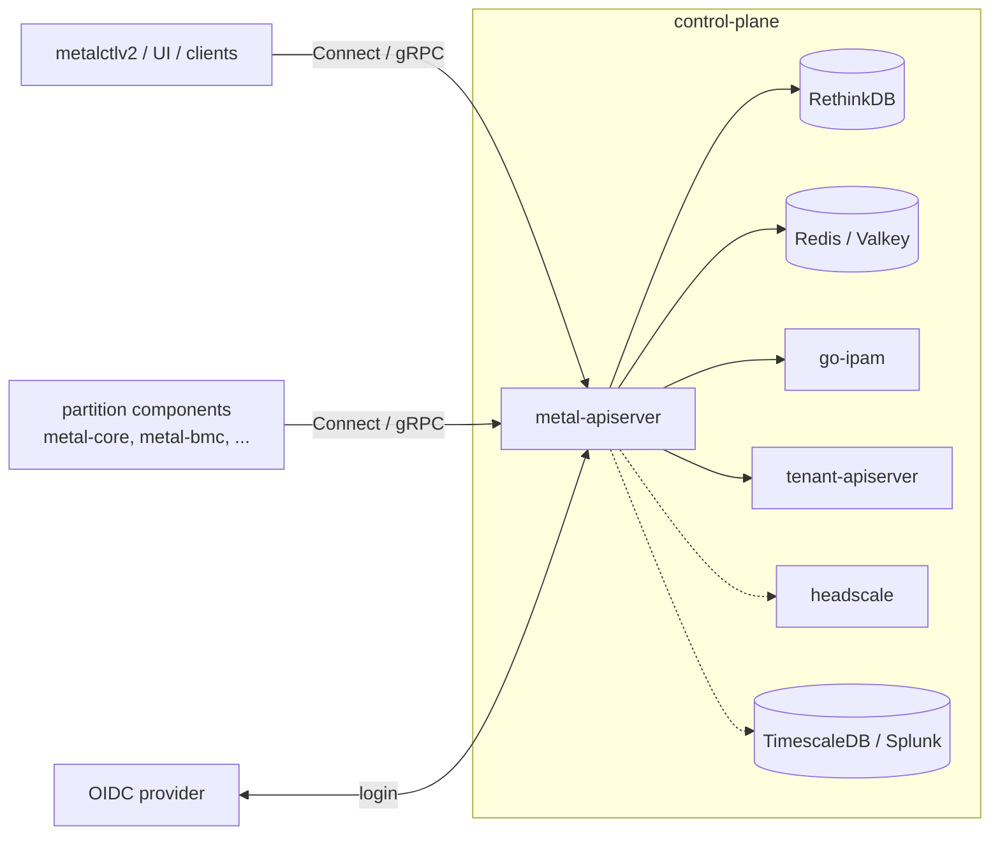

# metal-apiserver

[](https://github.com/metal-stack/metal-apiserver/actions)
[](https://metal-stack.slack.com/)
[](https://goreportcard.com/report/github.com/metal-stack/metal-apiserver)
[](https://codecov.io/gh/metal-stack/metal-apiserver)
[](https://pkg.go.dev/github.com/metal-stack/metal-apiserver)

The metal-apiserver is the central component of the metal-stack control plane. It implements the metal-stack [v2 API](https://github.com/metal-stack/api) and is both the public interface for users to manage machines, networks, IPs, images, sizes and so forth, and the interface for metal-stack components running inside a partition (metal-core, metal-bmc, metal-hammer, switch agents, ...).

Starting with the metal-stack v1.0.0 release, the metal-apiserver is the default API of metal-stack and supersedes the [metal-api](https://github.com/metal-stack/metal-api).

The CLI for using the API is `metalctlv2`, which lives in [metal-stack/cli](https://github.com/metal-stack/cli). Client libraries for Go and other languages are generated from the API definitions in [metal-stack/api](https://github.com/metal-stack/api).

## Features

- **[Connect](https://connectrpc.com/) based API**: every service can be consumed via the Connect protocol, gRPC and gRPC-Web over HTTP/1.1 and HTTP/2 (including h2c). Request validation is done with [protovalidate](https://github.com/bufbuild/protovalidate), gRPC health checking and server reflection are available.
- **Three API surfaces**:
  - `api` – services for tenants and projects (machines, IPs, networks, images, tokens, members, ...)
  - `admin` – services for operators of a metal-stack installation
  - `infra` – services used by metal-stack components inside a partition (boot, BMC, switches, events, components)
- **Authentication via OIDC** for human users and **JWT based API tokens** for automation, with fine-grained, role- and permission-based authorization. See [RBAC.md](RBAC.md) for all details.
- **Multi-tenancy** backed by the [tenant-apiserver](https://github.com/metal-stack/tenant-apiserver), including tenant and project memberships and invites.
- **IP address management** through [go-ipam](https://github.com/metal-stack/go-ipam).
- **Asynchronous task processing** (e.g. BMC commands, cross-backend transactions) based on [asynq](https://github.com/hibiken/asynq), see [pkg/async](pkg/async/README.md).
- **Machine lifecycle tracking** with a finite state machine and automatic machine issue detection.
- **Optional VPN access** to machines via [headscale](https://github.com/juanfont/headscale).
- **Auditing** to TimescaleDB and/or Splunk.
- **Rate limiting** per token and for unauthenticated access.
- **Observability**: structured logging, Prometheus metrics and OpenTelemetry instrumentation.

## Architecture



| Dependency                                                       | Required | Purpose                                                       |
| ---------------------------------------------------------------- | -------- | ------------------------------------------------------------- |
| [RethinkDB](https://rethinkdb.com/)                              | yes      | Primary datastore for all metal entities                     |
| Redis / [Valkey](https://valkey.io/)                             | yes      | Token store, rate limiting, async task queues                |
| [go-ipam](https://github.com/metal-stack/go-ipam)                | yes      | IP address and prefix management                              |
| [tenant-apiserver](https://github.com/metal-stack/tenant-apiserver) | yes   | Tenants, projects and their memberships                       |
| OIDC provider                                                    | yes      | User login (e.g. Zitadel, Keycloak, Dex, GitHub, ...)         |
| [headscale](https://github.com/juanfont/headscale)               | no       | VPN access to machines                                        |
| TimescaleDB / Splunk                                             | no       | Audit trail                                                   |

## Repository Layout

| Path                           | Content                                                                   |
| ------------------------------ | ------------------------------------------------------------------------- |
| `cmd/server`                   | Entrypoint and subcommands (`serve`, `datastore`, `token`, `vpn`)         |
| `pkg/service/{api,admin,infra}`| Implementations of the v2 API services                                    |
| `pkg/repository`               | Business logic and access to all backends                                 |
| `pkg/db`                       | RethinkDB datastore, entities, queries and migrations                     |
| `pkg/auth`, `pkg/token`        | Authentication, authorization and token handling                          |
| `pkg/async`                    | Asynchronous tasks and queues                                             |
| `pkg/fsm`, `pkg/issues`        | Machine state machine and machine issue evaluation                        |
| `pkg/headscale`, `pkg/vpn`     | VPN integration                                                           |
| `pkg/test`, `pkg/e2e`          | Test helpers (testcontainers based backends) and end-to-end tests         |

## Usage

The server binary provides the following subcommands:

```bash
server serve                 # start the api server
server datastore init        # initialize the datastore, required before the first start
server datastore migrate     # run datastore migrations (supports --dry-run and --target-version)
server token                 # create api tokens for services depending on the api-server
server vpn connected-machines # list machines connected via vpn
```

Every flag can also be set with an environment variable. Run `server serve --help` for the complete list. The most important ones are:

| Flag                         | Environment variable       | Description                                                     |
| ---------------------------- | -------------------------- | --------------------------------------------------------------- |
| `--http-server-endpoint`     | `HTTP_SERVER_ENDPOINT`     | Bind address of the API server (default `localhost:8081`)       |
| `--metric-server-endpoint`   | `METRIC_SERVER_ENDPOINT`   | Bind address of the metrics server (default `localhost:2112`)   |
| `--server-http-url`          | `SERVER_HTTP_URL`          | External URL of the API, used for OIDC callbacks                |
| `--session-secret`           | `SESSION_SECRET`           | Secret to encrypt the session cookie (required)                 |
| `--rethinkdb-addresses`      | `RETHINKDB_ADDRESSES`      | RethinkDB addresses (required)                                  |
| `--rethinkdb-password`       | `RETHINKDB_PASSWORD`       | RethinkDB password (required)                                   |
| `--redis-addr`               | `REDIS_ADDR`               | Address of Redis / Valkey                                       |
| `--ipam-grpc-endpoint`       | `IPAM_GRPC_ENDPOINT`       | go-ipam endpoint (default `http://ipam:9090`)                   |
| `--tenant-apiserver-baseurl` | `TENANT_APISERVER_BASEURL` | tenant-apiserver endpoint (default `http://tenant-apiserver:8080`) |
| `--oidc-discovery-url`       | `OIDC_DISCOVERY_URL`       | OIDC discovery URL (required)                                   |
| `--oidc-client-id`           | `OIDC_CLIENT_ID`           | OIDC client id (required)                                       |
| `--oidc-client-secret`       | `OIDC_CLIENT_SECRET`       | OIDC client secret (required)                                   |
| `--oidc-end-session-url`     | `OIDC_END_SESSION_URL`     | OIDC end session URL (required)                                 |
| `--provider-tenant`          | `PROVIDER_TENANT`          | Tenant whose members may obtain admin roles (default `metal-stack`) |
| `--headscale-enabled`        | `HEADSCALE_ENABLED`        | Enable VPN services via headscale                               |

## Deployment

The metal-apiserver is deployed as part of the metal-stack control plane with the [metal-roles](https://github.com/metal-stack/metal-roles) Ansible roles. Container images are built for every release.

For a local, fully functional environment including the metal-apiserver, use the [mini-lab](https://github.com/metal-stack/mini-lab). Please refer to the [metal-stack documentation](https://metal-stack.io) for an overview of all components.

## Development

Requirements: Go (see [go.mod](go.mod)) and Docker, as the tests start their backends (RethinkDB, Valkey, go-ipam, headscale, ...) with [testcontainers](https://testcontainers.com/).

```bash
make server   # build bin/server
make test     # run all tests with coverage
make golint   # run golangci-lint
make bench    # run benchmarks
```

To test changes in a running [mini-lab](https://github.com/metal-stack/mini-lab) (checked out next to this repository), build and deploy your local version with:

```bash
make mini-lab-push
```

## Contributing

Contributions are welcome! Please read the [contribution guidelines](https://metal-stack.io/community/contribution-guideline) and reach out on [Slack](https://metal-stack.slack.com/) if you have questions.

## License

This project is licensed under the [MIT License](LICENSE).
